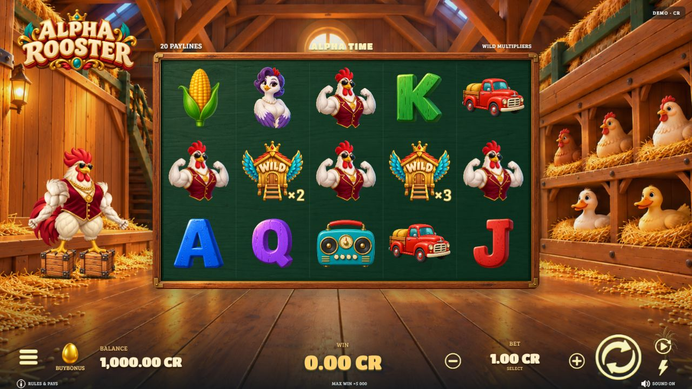

# Alpha Rooster

A cartoon barn slot frontend with a 5 × 3 reel grid, 20 paylines, a Spine-animated rooster, animated symbols and four distinct bonus presentations.



This portfolio export includes the v28 frontend source, raster runtime assets, audio and selected unit tests. It shows interface engineering, animation orchestration, responsive layouts, game-state handling, RGS integration and local game mathematics.

## Stack and features

- React 19, TypeScript, Vite 8, Spine 4.2 Canvas/WebGL.
- Golden Roost free spins, Barn Cascades, Golden Collect and Golden Hatch hold-and-respin presentations.
- Idle, drop and win animation states; animated character and environment; loading and welcome screens.
- Desktop and portrait layouts, reduced-motion handling, visibility-aware animation clocks and unfinished-round recovery.

## Run the source

Use Node.js 24 or newer:

```sh
npm ci
npm run dev
npm run build
npm test
```

Without RGS launch parameters, the game uses virtual credits and the included `public/demo-library.json` sample of local demonstration outcomes. This sample makes the frontend usable as a local demo; it is not the complete production math library. Server play requires an authorized RGS session. No live service credentials are included.

The original production math books and their 96% weighted RTP are not reproduced or certified by this export. Do not infer production readiness, platform approval, revenue or real-money operation from this repository. Historical source-art regeneration and studio-upload tooling are excluded.

## Rights and credits

See [LICENSE_NOTICE.md](LICENSE_NOTICE.md) and [LICENSES](LICENSES). Raster illustrations were produced with AI-assisted workflows and assembled into the game; third-party audio and fonts retain their own licenses. No open-source license is granted for the project-specific code or proprietary artwork.
